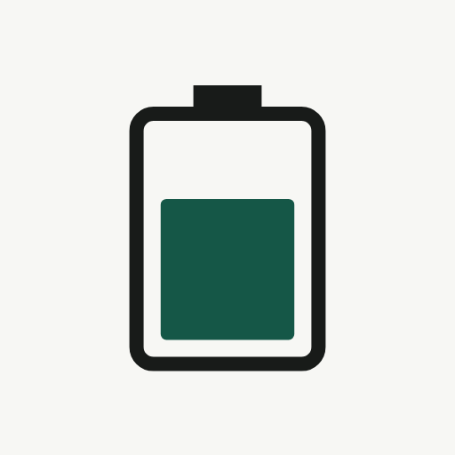
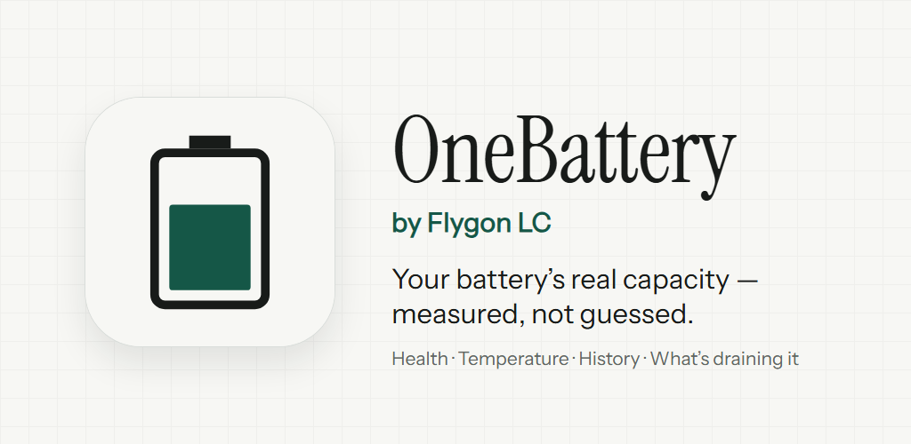

<p align="center">
  
</p>

# OneBattery by Flygon LC

**Your Android battery's real capacity, measured instead of guessed.**

OneBattery tracks your battery's level, temperature and history, and measures how much charge the battery can actually hold today compared with when it was new. It also shows which apps drain it. Everything stays on your phone: the app has no internet permission.

<p align="center"></p>

## Why the number in Settings is wrong

Android exposes a `BATTERY_PROPERTY_CHARGE_COUNTER` (remaining charge in µAh), and most "battery health" apps divide it by the percentage to estimate full capacity. On Samsung Galaxy phones, and some others, that counter is **not measured**: the firmware computes it as `level % × design capacity`. Dividing it by the level gives back the design capacity every time, so a three-year-old battery still reads "100%". The OS `health` field doesn't help either. It is a coarse enum (`GOOD`, `OVERHEAT`, `DEAD`, …) that reads `GOOD` until the battery is nearly finished.

The **current** reading (`BATTERY_PROPERTY_CURRENT_NOW`), on the other hand, comes from the fuel-gauge hardware. OneBattery uses it.

## How it measures: coulomb counting

1. A small foreground service reads the battery current every **10 s** while charging or while the screen is on, and every **30 s** otherwise.
2. It integrates current over time (trapezoidal rule) to get the **mAh that actually flowed** in or out.
3. Each measurement starts and ends exactly when the integer percentage **ticks over**, which removes the ±1% rounding error at both ends.
4. A segment is kept only if it covers **at least 15 percentage points** and at least **85% of its time** is covered by readings no more than 90 s apart. A gap longer than 10 minutes, or switching between charging and discharging, ends the segment.
5. **Capacity = mAh moved × 100 / percentage points moved.** For example, 1,380 mAh over a 30-point change means a full-charge capacity of 4,600 mAh.
6. The headline figure is a median over the last 60 days, weighted by span, so longer and more precise runs count more. It is shown as a percentage of design capacity, with an uncertainty of about ±5%.

While the phone is plugged in, the service holds a partial wake lock (the charger pays for it), so charging sessions produce clean, gap-free measurements. Unplugged, it lets the CPU sleep. Discharge measurements then happen only when there are no gaps, such as while you use the phone.

Vendors disagree on current units (µA vs mA) and sign conventions. OneBattery normalizes units by magnitude and learns the sign the first time it sees an unambiguous discharge.

## Features

- **Live status:** level, charging state and source, power in watts, voltage, temperature, cycle count (Android 14+) and estimated time to full.
- **Measured health:** full-charge capacity in mAh and as a percentage of design, with a trend chart. Each dot is one measured charge or discharge.
- **History:** level and temperature over time, charge sessions, and average discharge rate in %/h.
- **What's draining your battery:** with the screen on, measured current is charged to the app in the foreground. Screen-off drain goes into an "idle" bucket. The section also lists apps that Android's own records show running foreground services or using background data. Requires *Usage access*, which you can turn on and off at any time.
- **Ongoing notification** with an optional live readout and adjustable update cadence. Updates can pause while the screen is off.
- **Four themes**, which are the Flygon LC house styles. The launcher icon follows the selected theme.

| Theme | Character |
|---|---|
| **Flygon LC** | Pixel character, warm green, a little red used deliberately (Press Start 2P headings) |
| **Othello** | Harbor blue, warm neutrals, spacious editorial type (Source Sans 3) |
| **System Boring** | Paper and forest green. Quiet, legible, dependable (Instrument Serif / Instrument Sans) |
| **Night** | Dark, restrained, comfortable touch targets |

## Permissions and why each is needed

| Permission | Why |
|---|---|
| `FOREGROUND_SERVICE`, `FOREGROUND_SERVICE_SPECIAL_USE` | Coulomb counting needs a current reading every 10–30 s for hours. Android has no foreground-service type for continuous battery measurement, so the service is declared `specialUse` with the subtype *"Continuous battery current measurement for capacity tracking"*. Its notification is always visible. |
| `POST_NOTIFICATIONS` | Shows that required foreground-service notification, which can also show a live readout. |
| `WAKE_LOCK` | Keeps the CPU awake **only while plugged in**, so charge measurements have no gaps. WorkManager also uses it. |
| `RECEIVE_BOOT_COMPLETED` | Restarts monitoring after a reboot or app update, so you don't have to open the app. |
| `PACKAGE_USAGE_STATS` (*Usage access*, special app access that you grant in Settings) | Optional. Shows which app was in the foreground, so measured drain can be attributed to it, plus Android's own per-app foreground-service time and background data totals. Without it, the drain section is empty and everything else works. |
| `QUERY_ALL_PACKAGES` | Turns package names in the drain list into app names. **Scheduled for removal** in favor of a narrower `<queries>` declaration (see [docs/PLAY_STORE.md](docs/PLAY_STORE.md)). |
| `ACCESS_NETWORK_STATE` | Added automatically by WorkManager. It is used for job constraints, and OneBattery doesn't use it. |

There is **no** `INTERNET` permission. The app cannot send anything anywhere.

## Privacy

All readings, measurements and per-app drain totals are stored in a local SQLite database on the device. Raw samples and drain data are pruned after a year; capacity measurements are kept so the long-term trend survives. Uninstalling the app or clearing its storage deletes all of it. Nothing is collected, uploaded, shared or sold, and there are no analytics, ads or crash reporters. See [PRIVACY.md](PRIVACY.md).

## Building

Requirements: JDK 17 or newer (21 works), and the Android SDK with platform 35 installed (or Android Studio Meerkat or newer).

```bash
# Debug build
./gradlew assembleDebug

# Release APK (minified). Signed with your debug key unless keystore.properties exists.
./gradlew assembleRelease

# Play Store bundle (needs keystore.properties, see below)
./gradlew bundleRelease
```

### Release signing

Release builds read signing details from a **gitignored** `keystore.properties` in the project root:

```properties
storeFile=/absolute/or/project-relative/path/to/upload.jks
storePassword=...
keyAlias=...
keyPassword=...
```

If that file is missing, or you pass `-PdebugSigning`, release builds use the debug key, so forks and local sideloading need no setup. **Never commit keystores or `keystore.properties`.**

### Project layout

```
app/src/main/java/com/flygonlc/onebattery/
  BatteryReader.kt    reads BatteryManager and normalizes units and sign
  CoulombCounter.kt   capacity measurement (the core idea)
  MonitorService.kt   specialUse foreground service, 10–30 s sampling loop
  DrainTracker.kt     per-app drain attribution via UsageStats
  BatteryDb.kt        local SQLite storage
  Stats.kt            capacity estimate, discharge rate, sessions
  ui/                 Jetpack Compose UI and themes
fastlane/metadata/    Play Store listing text and graphics
docs/PLAY_STORE.md    Play publishing checklist and declarations
```

## Contributing

Issues and pull requests are welcome; see [CONTRIBUTING.md](CONTRIBUTING.md). Readings from devices other than Samsung Galaxy phones are especially useful, because current-sensor units and signs vary by vendor. To report a vulnerability, see [SECURITY.md](SECURITY.md).

## License

Copyright © 2026 Flygon LC. Licensed under the [MIT License](LICENSE).
The bundled fonts are licensed under the SIL Open Font License 1.1; see [NOTICE](NOTICE) and [THIRD_PARTY_NOTICES.md](THIRD_PARTY_NOTICES.md).

"Android" and "Google Play" are trademarks of Google LLC. "Samsung" and "Galaxy" are trademarks of Samsung Electronics Co., Ltd. OneBattery is not affiliated with either.
